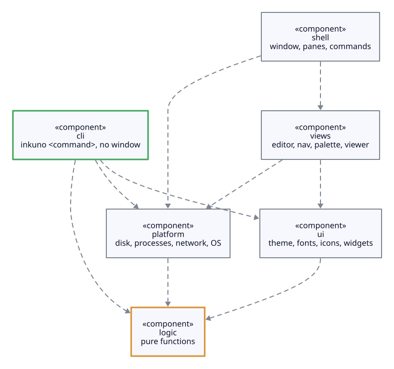
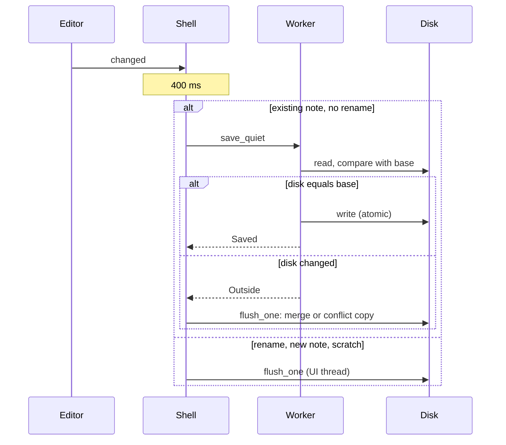

# Architecture

Inkuno is a Cargo workspace built on [GPUI](https://www.gpui.rs/) (`gpui-pre` 0.3.14, pinned): the app is the
crate `crates/inkuno`, the pure logic is `crates/inkuno-logic`, the outside world is `crates/inkuno-platform`, the look is `crates/inkuno-ui`, the read-only HTML viewer (`inkuno view`, tao + wry, no gpui, built when the `viewer` feature is on) is `crates/inkuno-view`, and the root manifest only lists them. This page is the
map: where things live, which way the dependencies go, and the rules the code keeps.

Inkuno's home is github.com/kolisachint/inkuno.

## Layers

```
crates/inkuno/src/
  main.rs      entry point: declares the layers; a first word that is not an option goes to cli::run(), else shell::run()
  lang.rs      tr("English", "Français"), re-exported from the logic crate
  actions.rs   the app's actions, dispatched by shortcuts, menus and the palette
  logic/       pure functions: no gpui, no disk, no window. Most modules moved to
               crates/inkuno-logic and are re-exported here, so every `crate::logic::…` path keeps working
  platform/    re-exports the crate `crates/inkuno-platform`: the outside world, disk, processes, network, OS (no gpui)
  ui/          re-exports the crate `crates/inkuno-ui`: the look shared by every view: theme, fonts and icons, widgets, figures
  views/       gpui entities: editor, side panel, palette, viewer, one-line field (its text: `crates/inkuno-ui/src/line.rs`)
  shell/       the window: owns the panes and the views, routes events, runs the commands
    tests/     the whole app driven by simulated keystrokes
  cli/         the command line, no window: the vault's commands (`inkuno list`, `read`, `new`,
               `edit`…, `commands.rs` and `ops.rs`), the vault rules (`store.rs`), `draw.rs`,
               `guide.rs`, `outcome.rs`, the saved versions (`rev.rs`), the shortcuts (`keys.rs`),
               `help` (`mod.rs`). Uses logic, platform, the pure parts of ui and the shortcut table
               of shell/keymap. Its texts stay in English and do not go through tr
```

A layer only uses the layers below it:

```
shell ──► views ──► ui ──► logic
  │         │              ▲
  └─────────┴──► platform ─┘        lang, actions: usable everywhere
cli ────────────► ui, logic, platform (and the shortcut table of shell/keymap)
```



*Diagrams.* A complex diagram has its source in `docs/diagrams/<name>.d2`. `scripts/diagrams.sh` renders it
(with [d2](https://d2lang.com)) to `docs/user/src/img/<name>.svg`, which is committed and embedded with ``.
Edit the `.d2` file, never the SVG, then run the script again. The SVG still opens in Inkuno's viewer.
A simple flow is an inline ` ```mermaid ` block in the Markdown itself. Inkuno draws class, sequence and state
diagrams from it (`crates/inkuno/src/logic/mermaid.rs`); other kinds are not drawn.

The test `layers_only_depend_downwards` fails when a file breaks this rule, and when a view
reaches into the shell.

## The shell

`Shell` (`shell/mod.rs`) is the window's state. Its methods are grouped by subject, one file
each, all `impl Shell`:

| File | Subject |
|---|---|
| `pane.rs` | the panes and their tabs, which one is active, the file a tab shows (`FileView`); splitting, moving a tab between panes, the saved layout. The panes are placed by the tree `crates/inkuno-logic/src/layout.rs` (`Node`, leaves = groups), drawn by `render_layout` |
| `tabs.rs` | the tab bar of a pane |
| `notes.rs` | opening, previewing, creating, saving notes; links and wikilinks; a rename rewrites the links to it |
| `library.rs` | the vault: choosing, scanning, watching, icons, backup, trash; the window's door for `inkuno show` (`listen`) |
| `sidebar.rs`, `files.rs`, `menu.rs`, `listing.rs` | the side panel, file operations, the context menu, list pages |
| `palette_open.rs` | every way the palette opens: notes, commands, comments, places |
| `help.rs`, `keymap.rs` | the help panel; the default shortcuts and their sections |
| `review.rs` | the Review view of the right dock (`app-ui.md` §23): the feed of the note's comments and pending changes, its cards, replies, Resolve, Accept and Reject; the feed's order and locations are pure (`inkuno-logic/src/review.rs`) |
| `comments.rs` | a comment being written from the editor: its draft (Enter writes it, Escape takes it out) and the note's corner badge |
| `assistant.rs` | the Assistant panel in the right dock: its conversation, the review, the prompt box, the state of the agent process it drives (`crates/inkuno-platform/src/assistant.rs`), and the writing of a review's comments into the note |
| `settings.rs`, `toasts.rs` | settings, status messages |
| `versions.rs` | the Versions panel (the saved versions of the active note) and the compare tab (`app-ui.md` §19) |
| `render.rs` | drawing the window |

A `Pane` is what **one tab** holds (a note, or a file in its place); `Shell::panes` lists every
tab of the window, shown or not, so what must reach every open note (saving, renames, the watcher,
the theme) loops over it with `each_pane` and `in_pane`. The active tab is `self.pane()` /
`self.pane_mut()`. A tab out of sight calls `Editor::rest` and keeps its text, cursor and undo
only. What the user opens goes through `Shell::open`: the tab that already shows the file,
otherwise a new tab (a preview or an empty tab is used in place); `open_note` loads into the
active tab and is for code that has already chosen it (restoring, reopening).
`Pane::displayed_path` identifies its current document, preferring `FileView` over the note kept
underneath. The tree uses it; the `path` field stays the note's identity for editing and saving.
A view talks to the shell only through its events (`EditorEvent`, `PaletteEvent`, `FieldEvent`).

## Where to look

| To change… | Go to |
|---|---|
| how Markdown is read (headings, links, tags, styles) | `crates/inkuno-logic/src/markdown/` (`mod.rs`; `tables.rs`, `lists.rs`, `front.rs`, `dates.rs`, `search.rs`) |
| Markdown tables (cells, paste, rows and columns, sort, format) | `crates/inkuno-logic/src/markdown/tables.rs`, drawn by `views/editor/table.rs` and `grid.rs` |
| the vault on disk (scan, save, rename, trash, config files) | `crates/inkuno-platform/src/vault.rs` |
| the vault commands (`inkuno list`, `read`, `new`, `edit`…) | `crates/inkuno/src/cli/commands.rs` (each command, its options and its help), `ops.rs` (the work), `store.rs` (the vault rules: nothing outside it, but `comment --file`, which reaches the one file it names), `outcome.rs` (results and disk errors in words); tests `crates/inkuno/tests/cli.rs` and `cli/check.rs`; `docs/design/cli.md` |
| the Assistant: the panel and its state | `shell/assistant.rs`; the design in `docs/design/app-ui.md` §16 and §18 (Improve) |
| pending changes: the washes, the read-only rule, accept, reject, comment | `views/editor/changes.rs` (the actions), `views/editor/edit.rs` (`touches_pending`), `shell/changes.rs` (the comment prompt and the hint); pure marks in `inkuno-logic/src/pending.rs`; the design in `docs/design/app-ui.md` §17 |
| the Assistant's child process (start, lines in and out, stop) | `crates/inkuno-platform/src/assistant.rs` (no window code) |
| the words of the Assistant: the prompts sent, the findings read back, the placing of each comment | `crates/inkuno-logic/src/assistant.rs` (pure); one comment is placed by `markdown::comment_on` (`crates/inkuno-logic/src/markdown/mod.rs`), the same as `inkuno comment` |
| the picture of a note, a file or a Mermaid source (`inkuno render`) | `crates/inkuno/src/cli/draw.rs`; `docs/design/cli.md` |
| the user guide from the command line (`inkuno guide`) | `crates/inkuno/src/cli/guide.rs` (the pages of `docs/user/src/`, built in) |
| the saved versions and the shortcuts from the command line (`inkuno rev`, `inkuno keys`) | `crates/inkuno/src/cli/rev.rs`, `keys.rs`; `docs/design/revisions.md` |
| a note's revisions (format, diffs, the folders that follow the note) | `crates/inkuno-logic/src/revision.rs` (format, paths, diffs), `crates/inkuno-platform/src/revisions.rs` (disk); `docs/design/revisions.md` |
| the Versions panel and the compare (a read-only tab against a version) | `shell/versions.rs`, `shell/sidebar.rs` (rows), `views/editor/` (`readonly`); `docs/design/app-ui.md` §19 |
| the window's door for `inkuno show` | `crates/inkuno-platform/src/link.rs` (127.0.0.1 and a secret in `<config>/inkuno/agent`), `Shell::listen` in `shell/library.rs` |
| a note written elsewhere while typed in | `crates/inkuno-logic/src/merge.rs` (three-way, by lines), `Shell::take_outside` in `shell/notes.rs` |
| background save of a note | `platform::vault::save_quiet` (`crates/inkuno-platform/src/vault.rs`), `Shell::flush_debounced` and the `Saving` slot in `shell/autosave.rs` |
| colours, themes, page width | `crates/inkuno-ui/src/theme.rs` |
| icons and fonts | `crates/inkuno-ui/src/assets.rs` |
| a reusable piece of UI (button, row, menu item, switch…) | `crates/inkuno-ui/src/components/` (one file per piece, named after its v2 class) |
| the text editor | `views/editor/`: `edit.rs` (changes, undo, the pending guard), `changes.rs` (accept, reject, comment on a pending change), `cursor.rs`, `style.rs`, `table.rs` and `grid.rs` (Markdown tables), `blocks.rs`, `find.rs`, `completion.rs`, `links.rs`, `notes.rs` (which cells of a table carry a comment), `format_bar.rs`, `mouse.rs`, `clipboard.rs`, `input.rs` (IME) |
| what a keystroke costs | `views/editor/layout.rs` (`reuse` redoes only the damaged lines) then `paint.rs`; the test `layout_reuse_matches_full_layout` checks every reuse against a full layout |
| the tree, recent notes, vault search, outline | `views/nav.rs` (state), `shell/sidebar.rs` (drawing) |
| the command palette | `views/palette.rs`, `shell/palette_open.rs` |
| a shortcut | `shell/keymap.rs` (`defaults`, `help_sections`), `crates/inkuno-ui/src/keys.rs` (how keys are read and shown) |
| the test of a feature | `shell/tests/` (`end_to_end/` is one session, one file per chapter) |
| the user guide | `docs/user/src/` (an mdBook); `shortcuts.md` is written from `help_sections` by the test `shortcuts_page_is_current` |

## How the main parts work

- **Editor**: a custom text element drawn directly with GPUI's text system. The layout is redone
  only when the text, the width, the theme or the cursor change, and then only for the lines an
  edit touched (the others are kept and shifted). A table of more than 1,500 lines is laid out
  light, with cells shaped only near the screen. A test compares every reused layout with a full
  one on thousands of random edits.
- **Typing rules** (`crates/inkuno-logic/src/markdown/lists.rs`): pure functions (`on_enter`, `renumber`) decide
  what Enter does on a list line and renumber the list around the cursor.
- **Vault** (`crates/inkuno-platform/src/vault.rs`): the note list, its tags and its text are indexed off the UI
  thread when the vault opens, then kept up to date on each save. Changes made elsewhere are
  reported by the `notify` crate; the vault is also rechecked on a slow timer, which becomes the
  only mechanism when watching is not possible. The watch knows the vault's root and its app
  folders in both spellings (as given, and canonical as the events carry them), built once at start.
- **Palette**: name matches first, then notes whose text contains every word. Names and texts are
  folded and lowered once, when the vault is read, not on each keystroke.
- **Navigation** (`views/nav.rs`, `shell/sidebar.rs`): the tree is rebuilt from the paths of the
  indexed notes, and only the visible rows are drawn.
- **Figures and SVG** (`crates/inkuno-ui/src/svg.rs`, `crates/inkuno-ui/src/figure.rs`, `views/viewer.rs`): SVG files, Mermaid blocks
  and LaTeX formulas are rasterized off the UI thread at a bounded size (at most 8,192 pixels a
  side and 16 million pixels). The viewer draws tiles of 512 pixels and keeps the last 64; a
  picture (`Source::Raster`) is not tiled, the graphics card draws it whole.
- **Startup**: the saved panes are restored before the first frame, so the window appears with its
  content. Icons are embedded in the binary. The command line never reaches that: `main` runs
  `cli::run()` for a command word and leaves before the window, so a command draws nothing and
  opens no window.
- **Command line**: each command reads the vault from disk once, does its work and exits. It
  writes with the same rules as the app: a taken name is refused, a write is atomic, a rename
  rewrites links, nothing is deleted. The window is not needed; an open window sees the files
  through its watcher, and `show` is the one command that asks it something.
- **Assistant**: the agent is a child process, the `hoocode` program in its RPC mode with no shell and no
  write tool (`crates/inkuno-platform/src/assistant.rs`, `FLAGS`), started on the first prompt and stopped at quit, a vault
  change or a new setting. `crates/inkuno-platform/src/assistant.rs` moves its lines; `shell/assistant.rs` shows them in the
  right dock. A review's findings are text in the agent's answer: Inkuno writes them into the note as one
  undo step. An improvement's proposal is text too, and lands as pending changes (`app-ui.md` §18). Nothing
  is linked in: hoocode is a separate program.
- **Window**: on Linux Inkuno draws its own title bar, shadow and resize edges (client-side
  decorations); on macOS and Windows the system does.

### Saving

- Typing changes the editor's text in memory only. Each change marks the note dirty and restarts a 400 ms
  timer (the `EditorEvent::Changed` handler in `shell/notes.rs`).
- When the timer ends, the shell calls `Shell::flush_debounced` (in `shell/autosave.rs`).
- An existing, dirty note with no title change and no comment-form migration is saved in the background by
  `platform::vault::save_quiet`, on the background executor, under `vault::save_lock`. It writes only if the disk
  still equals the pane's `base` (the text last saved). Otherwise it returns `Outside`, and `Shell::flush_one`
  (in `shell/notes.rs`) merges as before: `take_outside`, then `logic::merge::onto`; when the same lines changed,
  the other version is written beside the note as a conflict copy.
- Close, switch, quit, rename, new notes, scratch and conflicts use `flush_one` on the UI thread. It first settles
  the pane's `Saving` slot (`Shell::settle_saving`): a queued background save is cancelled, a running one is waited
  for and its outcome applied. So the last text is on disk before the window closes.
- Rewriting links in other notes after a heading rename first saves those notes' panes, and takes the save lock.
- Every write is atomic (`vault::write`: a temp file, `fsync`, then a rename), so a crash never leaves a truncated note.
- Remaining shortcut: a note that gains a `#` title stays on the synchronous path until it is reopened
  (`// ponytail:` on `pane.h1`).



## Rules

- **Nothing is destroyed or overwritten on disk**: atomic writes, a `.trash`
  folder, and a taken name is refused.
- **Interface text** always goes through `tr("English", "Français")`: the app is English-only for now and the French forms are being removed.
- **Pure first**: logic that can be a pure function lives in `crates/inkuno-logic/src/` (re-exported through `crates/inkuno-logic/src/`) and is unit-tested there;
  every user journey is tested end to end with simulated keystrokes (GPUI's test platform).
- **No new dependency** without asking: `Cargo.lock` comes from gpui-pre 0.3.14's and is fragile.
