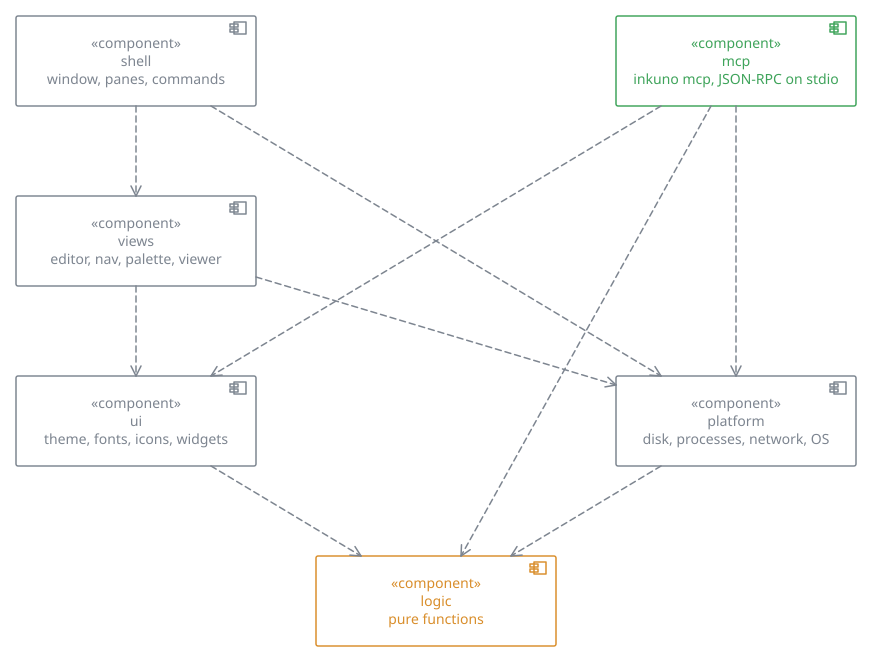

# Architecture

Inkuno is a Cargo workspace built on [GPUI](https://www.gpui.rs/) (pinned at 0.2.2): the app is the
crate `crates/inkuno`, the pure logic is `crates/inkuno-logic`, and the root manifest only lists them. This page is the
map: where things live, which way the dependencies go, and the rules the code keeps.

Inkuno is a rename of Bref by Andrea Larboullet Marin; its home is github.com/kolisachint/inkuno.

## Layers

```
crates/inkuno/src/
  main.rs      entry point: declares the layers, sends `inkuno mcp` to mcp::run(), then shell::run()
  lang.rs      tr("English", "Français"), re-exported from the logic crate
  actions.rs   the app's actions, dispatched by shortcuts, menus and the palette
  logic/       pure functions: no gpui, no disk, no window. Most modules moved to
               crates/inkuno-logic and are re-exported here, so every `crate::logic::…` path keeps working
  platform/    the outside world: disk, processes, network, OS (no gpui)
  ui/          the look shared by every view: theme, fonts and icons, widgets, figures
  views/       gpui entities: editor, side panel, palette, viewer, one-line field (its text: `ui/line.rs`)
  shell/       the window: owns the panes and the views, routes events, runs the commands
    tests/     the whole app driven by simulated keystrokes
  cli/         `inkuno rev`, `inkuno keys`, `inkuno help`: the command line, no window. Uses logic,
               platform, the pure parts of ui and the shortcut table of shell/keymap
  mcp/         `inkuno mcp`: JSON-RPC over stdio for an agent. Uses logic, platform and the pure
               parts of ui. Nothing uses it. Its texts stay in English and do not go through tr
```

A layer only uses the layers below it:

```
shell ──► views ──► ui ──► logic
  │         │              ▲
  └─────────┴──► platform ─┘        lang, actions: usable everywhere
mcp ────────────► ui, logic, platform
cli ────────────► ui, logic, platform (and the shortcut table of shell/keymap)
```



*The source is in the SVG, so Inkuno opens it in the viewer.*

The test `layers_only_depend_downwards` fails when a file breaks this rule, and when a view
reaches into the shell.

## The shell

`Shell` (`shell/mod.rs`) is the window's state. Its methods are grouped by subject, one file
each, all `impl Shell`:

| File | Subject |
|---|---|
| `pane.rs` | the panes and their tabs, which one is active, the file a tab shows (`FileView`); splitting, moving a tab between panes, the saved layout. The panes are placed by the tree `crates/inkuno-logic/src/layout.rs` (`Node`, leaves = groups), drawn by `render_layout` |
| `tabs.rs` | the tab bar of a pane |
| `notes.rs` | opening, previewing, creating, saving notes; links and wikilinks; a rename rewrites the links to it |
| `library.rs` | the vault: choosing, scanning, watching, icons, backup, trash; the window's door for `inkuno mcp` (`listen`) |
| `sidebar.rs`, `files.rs`, `menu.rs`, `listing.rs` | the side panel, file operations, the context menu, list pages |
| `palette_open.rs` | every way the palette opens: notes, commands, comments, places |
| `help.rs`, `keymap.rs` | the help panel; the default shortcuts and their sections |
| `settings.rs`, `toasts.rs` | settings, status messages |
| `render.rs` | drawing the window |

A `Pane` is what **one tab** holds (a note, or a file in its place); `Shell::panes` lists every
tab of the window, shown or not, so what must reach every open note (saving, renames, the watcher,
the theme) loops over it with `each_pane` and `in_pane`. The active tab is `self.pane()` /
`self.pane_mut()`. A tab out of sight calls `Editor::rest` and keeps its text, cursor and undo
only. What the user opens goes through `Shell::open`: the tab that already shows the file,
otherwise a new tab (a preview or an empty tab is used in place); `open_note` loads into the
active tab and is for code that has already chosen it (restoring, reopening).
`Pane::displayed_path` identifies its current document, preferring `FileView` over the note kept
underneath. The tree uses it; the `path` field stays the note's identity for editing and saving.
A view talks to the shell only through its events (`EditorEvent`, `PaletteEvent`, `FieldEvent`).

## Where to look

| To change… | Go to |
|---|---|
| how Markdown is read (headings, links, tags, styles) | `crates/inkuno-logic/src/markdown/` (`mod.rs`; `tables.rs`, `lists.rs`, `front.rs`, `dates.rs`, `search.rs`) |
| Markdown tables (cells, paste, rows and columns, sort, format) | `crates/inkuno-logic/src/markdown/tables.rs`, drawn by `views/editor/table.rs` and `grid.rs` |
| the vault on disk (scan, save, rename, trash, config files) | `platform/vault.rs` |
| the command line (`inkuno rev`, `inkuno keys`, `inkuno help`) | `crates/inkuno/src/cli/` (`rev.rs`, `keys.rs`); tests `crates/inkuno/tests/cli.rs`; `docs/design/revisions.md` |
| a note's revisions (format, diffs, the folders that follow the note) | `crates/inkuno-logic/src/revision.rs` (format, paths, diffs), `platform/revisions.rs` (disk); `docs/design/revisions.md` |
| the window's door for `inkuno mcp` (`show`) | `platform/link.rs` (127.0.0.1 and a secret in `<config>/inkuno/agent`), `Shell::listen` in `shell/library.rs` |
| a note written elsewhere while typed in | `crates/inkuno-logic/src/merge.rs` (three-way, by lines), `Shell::take_outside` in `shell/notes.rs` |
| colours, themes, page width | `ui/theme.rs` |
| icons and fonts | `ui/assets.rs` |
| the text editor | `views/editor/`: `edit.rs` (changes, undo), `cursor.rs`, `style.rs`, `table.rs` and `grid.rs` (Markdown tables), `blocks.rs`, `find.rs`, `completion.rs`, `links.rs`, `notes.rs` (which cells of a table carry a comment), `format_bar.rs`, `mouse.rs`, `clipboard.rs`, `input.rs` (IME) |
| what a keystroke costs | `views/editor/layout.rs` (`reuse` redoes only the damaged lines) then `paint.rs`; the test `layout_reuse_matches_full_layout` checks every reuse against a full layout |
| the tree, recent notes, vault search, outline | `views/nav.rs` (state), `shell/sidebar.rs` (drawing) |
| the command palette | `views/palette.rs`, `shell/palette_open.rs` |
| a shortcut | `shell/keymap.rs` (`defaults`, `help_sections`), `ui/keys.rs` (how keys are read and shown) |
| the test of a feature | `shell/tests/` (`end_to_end/` is one session, one file per chapter) |
| the user guide | `docs/user/src/` (an mdBook); `shortcuts.md` is written from `help_sections` by the test `shortcuts_page_is_current` |
| the MCP server (`inkuno mcp`) | `crates/inkuno/src/mcp/` (`mod.rs` the protocol; `notes.rs` reading and writing; `draw.rs` figures to PNG (`logic/mermaid.rs` `kind()` names the diagram kind); `guide.rs` resources and prompts; `tools.rs` the tool list; `vault.rs` the agent's vault); `main` routes `mcp` before the window. Checked by `crates/inkuno/src/mcp/check.rs` |

## How the main parts work

- **Editor**: a custom text element drawn directly with GPUI's text system. The layout is redone
  only when the text, the width, the theme or the cursor change, and then only for the lines an
  edit touched (the others are kept and shifted). A table of more than 1,500 lines is laid out
  light, with cells shaped only near the screen. A test compares every reused layout with a full
  one on thousands of random edits.
- **Typing rules** (`crates/inkuno-logic/src/markdown/lists.rs`): pure functions (`on_enter`, `renumber`) decide
  what Enter does on a list line and renumber the list around the cursor.
- **Vault** (`platform/vault.rs`): the note list, its tags and its text are indexed off the UI
  thread when the vault opens, then kept up to date on each save. Changes made elsewhere are
  reported by the `notify` crate; the vault is also rechecked on a slow timer, which becomes the
  only mechanism when watching is not possible.
- **Palette**: name matches first, then notes whose text contains every word. Names and texts are
  folded and lowered once, when the vault is read, not on each keystroke.
- **Navigation** (`views/nav.rs`, `shell/sidebar.rs`): the tree is rebuilt from the paths of the
  indexed notes, and only the visible rows are drawn.
- **Figures and SVG** (`ui/svg.rs`, `ui/figure.rs`, `views/viewer.rs`): SVG files, Mermaid blocks
  and LaTeX formulas are rasterized off the UI thread at a bounded size (at most 8,192 pixels a
  side and 16 million pixels). The viewer draws tiles of 512 pixels and keeps the last 64; a
  picture (`Source::Raster`) is not tiled, the graphics card draws it whole.
- **Startup**: the saved panes are restored before the first frame, so the window appears with its
  content. Icons are embedded in the binary. `inkuno mcp` never reaches that: `main` runs
  `mcp::run()` and leaves before the window, one JSON-RPC message at a time, stdout reserved for
  the protocol.
- **Agents**: the server refreshes the vault's index on each call. It writes with the same rules
  as the app: a taken name is refused, a write is atomic, a rename rewrites links, nothing is
  deleted.
- **Window**: on Linux Inkuno draws its own title bar, shadow and resize edges (client-side
  decorations); on macOS and Windows the system does.

## Rules

- **Nothing is destroyed or overwritten on disk**: atomic writes, a `.trash`
  folder, and a taken name is refused.
- **Interface text** always goes through `tr("English", "Français")`: the app is English-only for now and the French forms are being removed.
- **Pure first**: logic that can be a pure function lives in `crates/inkuno-logic/src/` (re-exported through `crates/inkuno-logic/src/`) and is unit-tested there;
  every user journey is tested end to end with simulated keystrokes (GPUI's test platform).
- **No new dependency** without asking: `Cargo.lock` comes from GPUI 0.2.2's and is fragile.
