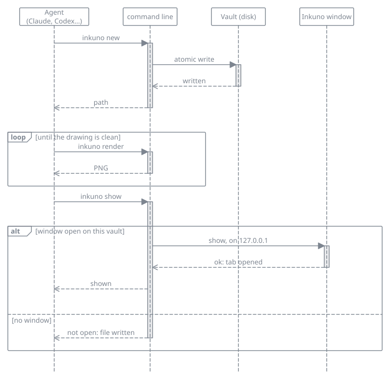
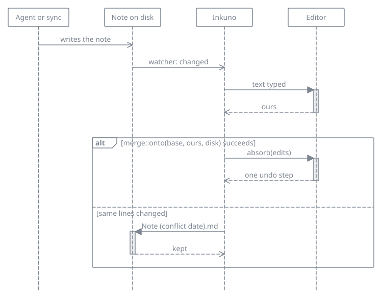

# Agents (MCP)

`inkuno mcp` is a [Model Context Protocol](https://modelcontextprotocol.io) server in the same program as Inkuno. An agent (Claude Code, Claude Desktop, Codex CLI, Gemini CLI, Cursor, VS Code) can read the vault, write notes and add Mermaid diagrams to them, and Inkuno shows the files. The agent does not get a generic folder: it gets Inkuno's links, its trash, and its diagrams.

The server speaks JSON-RPC over the standard input and output of the process. It does not open a window and it does not use the network: `show` reaches the open Inkuno window through 127.0.0.1, on this computer only.

## Setting it up

### 1. The path of the program

The client starts Inkuno itself, often without the `PATH` of your terminal (Claude Desktop on macOS, for one). Give it the full path of the program:

| Installed with | Path |
|---|---|
| `sudo make install` | `/usr/local/bin/inkuno`, or `/usr/bin/inkuno` with `PREFIX=/usr` |
| `cargo install` | `~/.cargo/bin/inkuno` |
| The macOS disk image | `/Applications/Inkuno.app/Contents/MacOS/inkuno` |

The examples below use `/usr/bin/inkuno`: put yours. A configuration file does not expand `~`: write the whole path.

### 2. The arguments

The first argument is always `mcp`. The server works on the vault Inkuno has open when the server starts: after opening another vault in Inkuno, restart the server (in most clients, restart the client). Two more arguments, after `mcp`, change that:

- `--vault <folder>`: another vault, or a vault for a computer where Inkuno has never been opened.
- `--read-only`: only the tools that read. The agent cannot write, rename or trash anything.

### 3. The client

#### Claude Code

```bash
claude mcp add --scope user inkuno -- /usr/bin/inkuno mcp
```

Everything after `--` is the command and its arguments. `--scope user` makes Inkuno available in every project; without it, only in the current one. `--scope project` writes it in `.mcp.json` at the root of the project, to share with the people who work on it.

To check: `claude mcp list` shows `inkuno` with `✔ Connected`, and `/mcp` lists it in a session.

#### Claude Desktop

In Claude Desktop, open **Settings**, then **Developer**, then **Edit Config**. That opens `claude_desktop_config.json`:

| System | File |
|---|---|
| macOS | `~/Library/Application Support/Claude/claude_desktop_config.json` |
| Windows | `%APPDATA%\Claude\claude_desktop_config.json` |
| Linux | `~/.config/Claude/claude_desktop_config.json` |

Add `inkuno` to `mcpServers`, next to the servers already there:

```json
{
  "mcpServers": {
    "inkuno": {
      "command": "/Applications/Inkuno.app/Contents/MacOS/inkuno",
      "args": ["mcp"]
    }
  }
}
```

Quit Claude Desktop completely and start it again. Inkuno is then in the list of connectors of the message box. If it is not, the file `mcp-server-inkuno.log` in the logs folder says why: `~/Library/Logs/Claude` on macOS, `%APPDATA%\Claude\logs` on Windows, `~/.config/Claude/logs` on Linux.

#### Codex CLI

```bash
codex mcp add inkuno -- /usr/bin/inkuno mcp
```

Or by hand, in `~/.codex/config.toml`:

```toml
[mcp_servers.inkuno]
command = "/usr/bin/inkuno"
args = ["mcp"]
```

To check: `codex mcp list`, or `/mcp` in a session.

#### Gemini CLI

```bash
gemini mcp add --scope user inkuno /usr/bin/inkuno mcp
```

Without `--scope user`, the server is written in `.gemini/settings.json` of the current project. By hand, it goes in `mcpServers` of `~/.gemini/settings.json`, as for Claude Desktop. To check: `gemini mcp list`.

#### Cursor

In `~/.cursor/mcp.json` for every project, or `.cursor/mcp.json` for one:

```json
{
  "mcpServers": {
    "inkuno": {
      "type": "stdio",
      "command": "/usr/bin/inkuno",
      "args": ["mcp"]
    }
  }
}
```

#### VS Code

Run **MCP: Add Server** from the command palette, choose **Command (stdio)**, type `/usr/bin/inkuno mcp`, and name it `inkuno`. By hand, in `.vscode/mcp.json`, the key is `servers` and `type` is required:

```json
{
  "servers": {
    "inkuno": {
      "type": "stdio",
      "command": "/usr/bin/inkuno",
      "args": ["mcp"]
    }
  }
}
```

#### Other clients

Most read the `mcpServers` object shown for Claude Desktop: a `command`, the full path of Inkuno, and `args`, `["mcp"]`.

### 4. Check that it works

Ask the agent to call `vault_info` from the `inkuno` server. It answers with the folder of your vault and how many notes it holds.

- ``no vault: open one in Inkuno, or pass `--vault` ``: Inkuno has never opened a vault on this computer. Open one in Inkuno, or add `--vault` and its folder after `mcp`.
- `the vault in the config no longer exists`: the vault Inkuno last opened was moved or deleted. Open it again in Inkuno, or pass `--vault`.
- The client says the server failed to start: the path is wrong. Copy it from the table above and check that the file is there.

To see every tool, resource and prompt without an agent, the MCP Inspector starts the server and lists them (it needs Node.js):

```bash
npx @modelcontextprotocol/inspector /usr/bin/inkuno mcp
```

## What the agent can do

Reading: the shape of the vault, a list, a search ranked like the palette, one note (a heading or a block), its links and its tags.

Writing: create a note, replace a passage that occurs once, append, rename (links follow, unless another note still has the old name), move to the trash and bring back, the daily note, a comment on one passage.

Diagrams: Mermaid diagrams live in notes as ```mermaid blocks; `render` draws one to PNG to check it, and `check_mermaid` checks a source with no vault.

Showing: when Inkuno is open on the same vault, the agent can open a note, a diagram or a table in a tab of its own (`show`), and the window comes to the front. When Inkuno is closed, or has another vault open, it says so; the files are written all the same.



*Drawn by an agent with this server.*

The user guide is a resource (`inkuno://guide/writing`, `links`, `comments`, and the other pages).

## Command line

The same `inkuno` program answers from a terminal or a script, with no window. It works whether or not the app is open. An open app sees the notes and versions the command line writes at once; the shortcut and theme files it reads at its next start.

- `inkuno rev save <note> [--author NAME] [-m TEXT]`: saves the note's text as a new version and prints its number. Refused, with nothing written, when the text is the latest version's already.
- `inkuno rev list <note> [--json]`: the versions, newest first: number, date, author, kind, note.
- `inkuno rev show <note> <n> [--json]`: the full text of version `n` (with `--json`, its header and text).
- `inkuno rev diff <note> [<a>] [<b>] [--format unified|critic]`: no number compares the latest version with the file as it is now; one number compares that version with the file; two compare `a` with `b`. `unified` (the default) is a patch that `patch` applies; `critic` marks changes inline as `{--removed--}` and `{++added++}`.
- `inkuno keys list [--json]`: every shortcut, its chord now, and whether it was changed.
- `inkuno keys set <action> <chord>` and `inkuno keys reset <action>...`: change the shortcuts in `keybindings.json`. A chord is refused when it types text or when another action has it.
- `inkuno help rev` and `inkuno help keys`, or `--help` after either word, give each command with an example.

Errors go to standard error with exit status 1; a wrong command line exits with 2.

**Which vault.** The note's vault is the nearest folder above it that holds an `.inkuno` folder. Failing that, it is the vault the app has open, when the note is in it. Failing that, the note's own folder. A note in the app's scratch folder keeps its versions there.

**The author.** `--author` if given; else the author setting of the app (`revision author…` in the palette); else the `INKUNO_AUTHOR` variable; else your system user name; else `unknown`.

**Reading the files.** An agent does not need the command line to read the versions. They are in `.inkuno/revisions/`, next to the note's path in the vault (`ideas/plan.md` is `.inkuno/revisions/ideas/plan.md/0001.md`, `0002.md`…). Each file opens with a front matter block (`revision`, `parent`, `author`, `date`, `kind`, `note`), then the note's text, exactly as it was. The folder is hidden from the tree and the search.

## Prompts

A prompt is a request written in advance that you start yourself: the agent cannot run one. Your client fills it with your arguments and sends it as if you had typed it. Inkuno offers six:

| Prompt | Arguments, in order | What the agent does |
|---|---|---|
| `document_feature` | `feature`, then `code` (optional) | reads the guide, looks for notes that already mention the feature, writes a note with a class diagram and a sequence diagram, then shows it in Inkuno |
| `architecture_overview` | `project` | a hub note, a component diagram, a package diagram, and one note per part |
| `review_note` | `note` | comments on the passages that need them, and no other change to the note |
| `weekly_review` | `date` (optional, `YYYY-MM-DD`, default today) | reads the daily notes of that week, Monday to Sunday, and writes one note that sums it up, with links to the days and the notes they mention; a day without a note stays without one |
| `link_orphans` | `folder` (optional, default the whole vault) | finds the notes with no link in or out and proposes, for each, the note and the sentence where a link to it would go; it changes nothing until you choose |
| `tidy_tags` | none | groups the tags that mean the same (case, accents, plural, typo) and proposes the one to keep; it changes nothing until you agree |

In Claude Code, type `/` to see them as `/inkuno:document_feature (MCP)`, or type the full name followed by the arguments:

```text
/mcp__inkuno__review_note Roadmap
/mcp__inkuno__weekly_review 2026-10-28
/mcp__inkuno__tidy_tags
```

Arguments are split on spaces, so each one is a single word: write `issue-93`, not `issue 93`, and pass a path rather than a sentence. For a longer request, send an ordinary message instead. Other clients show prompts in their own menu, under the name of the server.

## Asking for a documented feature

Give the agent the work and say where it goes, for example:

> Implement issue 93. Then document it in my Inkuno notes with the `inkuno` server: a note on what changed and why, a technical part, a class diagram of the main types and a sequence diagram of the main scenario, as Mermaid blocks. Render each diagram and fix it until it is clean.

Clients that show prompts offer the same as **document_feature**: a class diagram of the main types and a sequence diagram of the main scenario, each in a ```mermaid block in the note, rendered and fixed until clean. Ask for one diagram per question the reader has. A diagram that reads badly can be named in a second message: "the sequence diagram has too many lifelines, split the error path into its own".

## What it will not do

- Leave the vault. An absolute path, `..`, or a link that steps outside is refused. Hidden folders are not listed.
- Delete a file. The trash is the only way out, and a name that is already taken is refused.
- Overwrite a note that changed after it was read. `read_note` returns a revision; `edit_note` with an old revision is refused. Here a revision is that token, for the note's text as it is now; it is not a saved version (see [Versions](writing.md#versions) and `inkuno rev`).
- Open the network, run a program, or touch git.

A note's text is data. It is not an instruction to the agent.

## While you have the note open

What another program writes shows up in Inkuno within about half a second, with the cursor and the scroll where they were. If you are typing in that note at that moment, Inkuno merges: the agent's change joins your text, and a single undo takes it back. When you both changed the same lines, your version stays in the note and the agent's is written next to it, as `Note (conflict 2026-10-31).md`, the way a sync conflict is, and a message says so. Nothing is lost either way.


