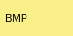

# Media

An image reference to a file that does not exist in the vault:

A picture in the note's folder, in JPEG, PNG and SVG (the photo is 320 pixels wide, the column is narrower):

A BMP, and a file that is not an image at all, which shows a placeholder with its alternative text:

A picture from the web, fetched once (GitHub avatar), and the same one sized with HTML attributes:

A web address that does not answer, in a placeholder:

A linked image, where the outer link wraps the image:

Text after the images, to check the spacing around a block that failed to load.
